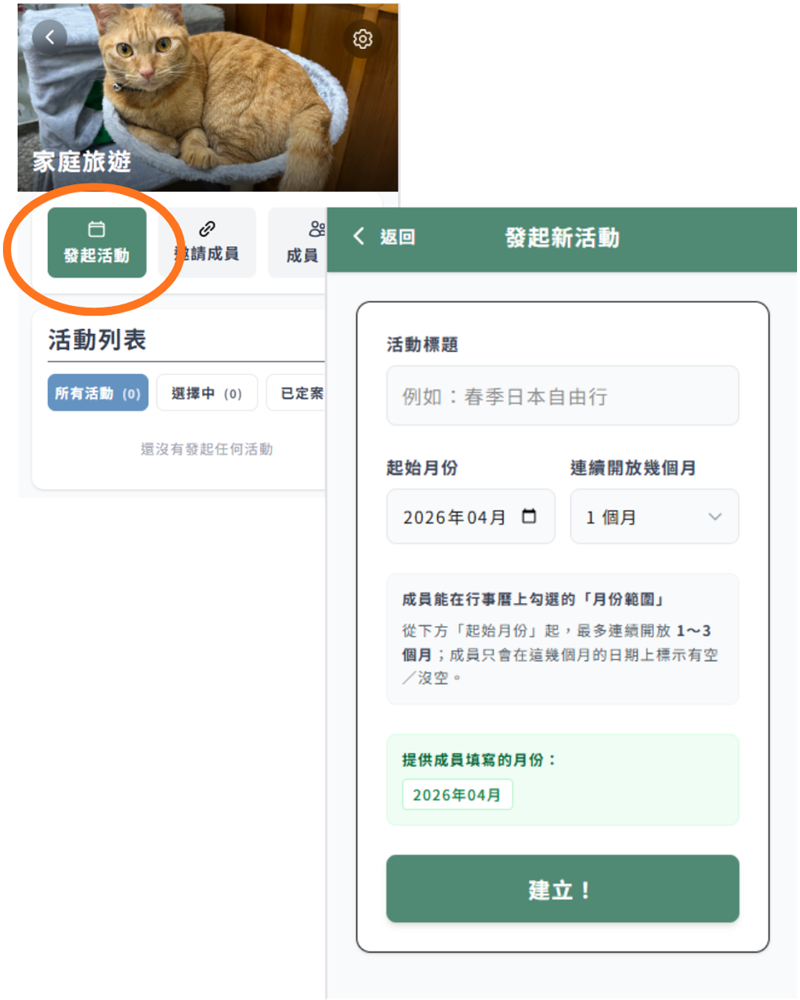
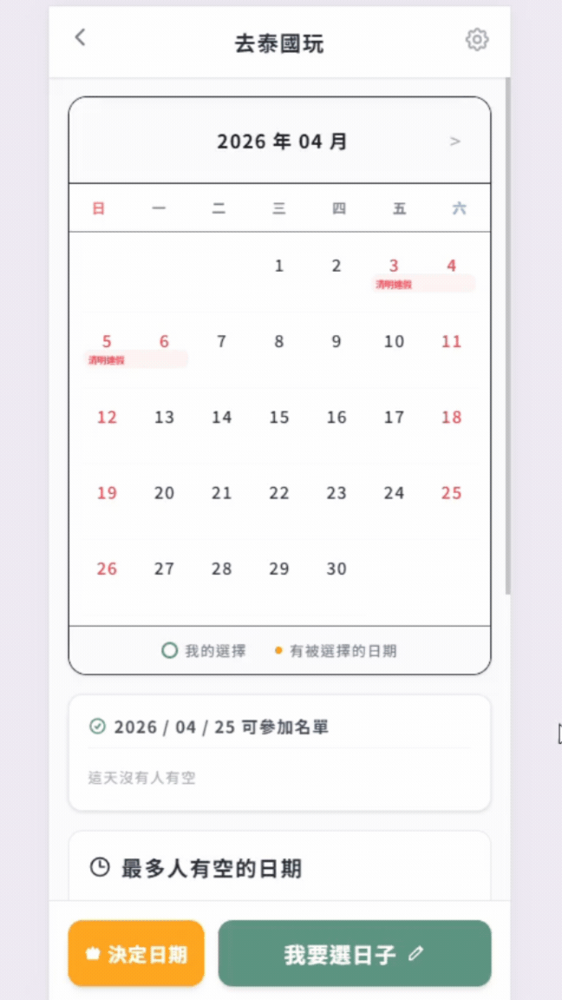
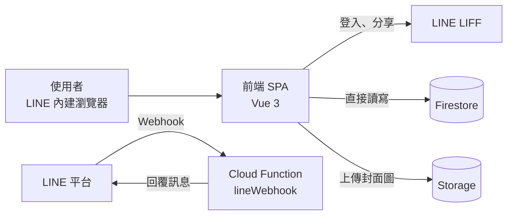

# 揪吉 JiuJi

在 LINE 裡使用的群組排時間工具。主揪建立活動，成員在月曆上勾選有空的日子，系統自動統計最多人有空的前三名，主揪一鍵定案並分享到 LINE 聊天室。

使用 Vue 3 + LINE LIFF + Firebase 打造，無自建伺服器。

> 線上服務需在 LINE 內開啟（LIFF），因此沒有公開網址可直接試用。畫面請見下方展示。

## 畫面展示

| 發起活動 | 勾選有空的日子 | 主揪定案 |
|:---:|:---:|:---:|
|  |  |  |

## 功能

- **群組**：建立群組、設定封面圖、管理成員（admin、editor、viewer 三種角色）
- **虛擬成員**：主揪可先為還沒加入的朋友建立名額並代填空檔，本人點邀請連結後認領身分
- **活動**：每個群組可有多個活動，每個活動開放 1～3 個月供成員填寫
- **月曆填寫**：以月曆勾選有空的日期、顯示台灣假日、點日期查看當天誰有空
- **統計與定案**：自動算出最多人有空的 Top 3，主揪可選日期與時間定案，定案後鎖定填寫
- **分享到 LINE**：邀請卡片、填寫提醒與定案通知，由主揪透過 LIFF 分享目標選擇器送到任何聊天室；不支援時改為複製文字
- **其他**：訪客預覽模式、群組動作紀錄、活動列表分頁、下拉重新整理、使用教學輪播

## 技術棧

| 層級 | 技術 |
|---|---|
| 前端 | Vue 3、Vue Router（Hash 模式）、Vite 7、Tailwind CSS 4、date-fns、Swiper |
| LINE 整合 | LINE LIFF SDK（登入與分享）、LINE Messaging API（機器人回覆） |
| 後端與資料 | Firebase：Firestore、Cloud Storage、Hosting、Cloud Functions（Node.js）、Anonymous Auth |

## 系統架構

前端單頁應用在 LINE 內建瀏覽器執行，**直接以 Firebase SDK 讀寫 Firestore**，沒有自建的 API 層。Cloud Functions 只負責接收 LINE Webhook，在使用者加好友或傳訊息時回覆「打開排程」按鈕。



完整的 C4 架構圖（System Context 與 Container）見 [docs/architecture.md](docs/architecture.md)。

## 技術亮點

- **Serverless 架構**：前端直連 Firestore，後端程式碼只剩一個 Webhook 函式，由一人即可維運（[ADR-0002](docs/adr/0002-use-firebase-as-backend-platform.md)）
- **LIFF 整合**：以 `liff.getProfile()` 取得使用者身分，並用 `shareTargetPicker` 讓機器人不必加入群組（[ADR-0001](docs/adr/0001-use-line-liff-as-delivery-platform.md)、[ADR-0003](docs/adr/0003-share-via-liff-instead-of-bot-in-group.md)）
- **多人同時填寫不互相覆蓋**：以 Firestore 欄位路徑 `availabilities.{userId}` 只更新自己的資料
- **反正規化的資料模型**：同時存 `memberIds`（陣列，供 `array-contains` 查詢）與 `members`（詳細資料），見 [docs/data-model.md](docs/data-model.md)
- **虛擬成員與身分認領**：認領時走訪所有活動，把空檔資料從虛擬 id 搬到真實 `userId`
- **有效率的列表查詢**：活動列表以游標分頁，數量統計使用 `getCountFromServer` 聚合，不需下載整批資料

## 專案結構

```
.
├─ src/
│  ├─ App.vue              LIFF 初始化與使用者身分（provide 給各頁面）
│  ├─ router/              路由與登入守衛
│  ├─ views/               頁面（群組、活動、邀請認領等）
│  ├─ components/          可重用元件（月曆、定案彈窗、邀請彈窗等）
│  ├─ config/liff.js       LIFF ID 與分享網址
│  └─ utils/               Firebase 初始化、動作紀錄、訪客預覽、假日資料
├─ functions/              Cloud Functions（LINE Webhook）
├─ docs/                   技術文件（架構、流程、資料模型、ADR）
├─ firebase.json           Hosting、Functions、Storage 設定
└─ storage.rules           Storage 存取規則
```

## 本地開發

### 環境需求

- Node.js 20.19 以上或 22.12 以上（Vite 7 的需求）
- Cloud Functions 使用 Node.js 24（見 `functions/package.json` 的 `engines`）

### 啟動前端

```bash
npm install
npm run dev
```

開發模式（`npm run dev`）不需要 LINE 登入，程式會使用模擬帳號 `test_user_001`。

> **注意**：目前前端的 Firebase 設定直接寫在 `src/utils/firebase.js`，沒有分開發與正式環境，也沒有連接 Emulator。若要在自己的環境開發，請先建立自己的 Firebase 專案並替換設定，以免寫入他人的資料庫。

### 設定自己的 Firebase 與 LINE 專案

1. 到 [Firebase Console](https://console.firebase.google.com) 建立專案，啟用 **Firestore**、**Storage**，並在 Authentication 啟用 **匿名登入**。
2. 把 `src/utils/firebase.js` 的 `firebaseConfig` 換成你的專案設定，並更新 `.firebaserc` 的專案 ID。
3. Firestore 的 Security Rules 請依需求自行設定並納入版本控制。
4. 到 [LINE Developers Console](https://developers.line.biz) 建立 LIFF 應用（Endpoint URL 填 Hosting 網址），並依官方文件啟用分享目標選擇器相關設定；把 LIFF ID 填入 `src/config/liff.js`。
5. 建立 Messaging API 頻道，並把部署後的 `lineWebhook` 網址填入 Webhook URL。

### 環境變數（Cloud Functions）

Cloud Functions 的機密設定放在 `functions/.env`（已被 `.gitignore` 排除，不會提交）。複製範本後填入你自己的值：

```bash
cp functions/.env.example functions/.env
```

| 變數 | 必填 | 說明 |
|---|---|---|
| `CHANNEL_ACCESS_TOKEN` | 是 | Messaging API 頻道的 Channel access token |
| `CHANNEL_SECRET` | 是 | Messaging API 頻道的 Channel secret |
| `LIFF_ID` | 否 | LIFF ID；未設定時使用程式內的預設值 |

> 前端的 Firebase 設定與 LIFF ID 目前直接寫在程式碼中（`src/utils/firebase.js`、`src/config/liff.js`），不是透過環境變數。

## 部署

```bash
# 前端：建置並部署到 Firebase Hosting
npm run build
firebase deploy --only hosting

# Cloud Functions
cd functions && npm install && cd ..
firebase deploy --only functions

# 或一次部署全部（建置 + 全部）
npm run deploy
```

## 權限說明

- **admin**：群組建立者，可編輯群組、管理成員、刪除群組，並可管理所有活動
- **editor**：可發起活動，對自己建立的活動有完整管理權，並可代填虛擬成員的空檔
- **viewer**：可檢視群組與活動，並填寫自己的空檔

活動的編輯、刪除與定案僅限活動建立者與群組 admin；**定案僅限活動建立者**。

## 技術文件

| 文件 | 內容 |
|---|---|
| [docs/architecture.md](docs/architecture.md) | C4 架構圖（System Context、Container） |
| [docs/core-flow.md](docs/core-flow.md) | 建立揪團 → 填寫空檔 → 顯示結果的流程與時序圖 |
| [docs/data-model.md](docs/data-model.md) | Firestore 資料模型與 ER 圖 |
| [docs/adr/](docs/adr/) | 架構決策紀錄（ADR）：為什麼用 LIFF、Firebase、LIFF 分享 |

## 已知限制與未來規劃

- 加入即時同步，讓他人填寫的結果不需重新整理就能看到
- 加入伺服器端排程提醒（例如活動前一天）
- 強化身分驗證與權限控管
- 讓認領身分、刪除群組等跨多份文件的操作具備一致性保障
- 補上自動化測試與 CI
- 假日資料目前為 2026 年，需逐年更新
- 搜尋、深色模式、匯出定案結果

## 授權

本專案以 [MIT License](LICENSE) 授權。
