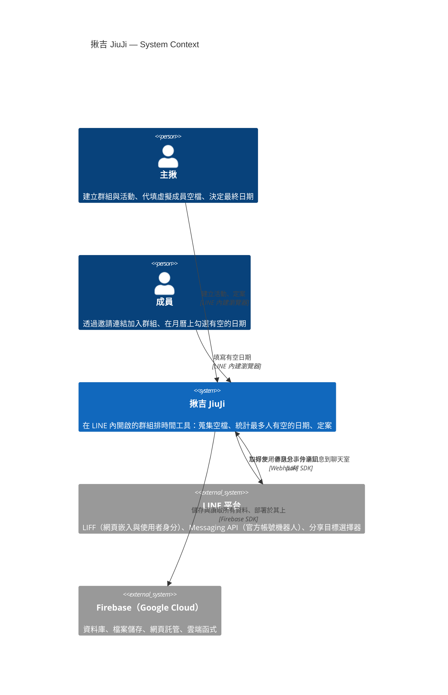
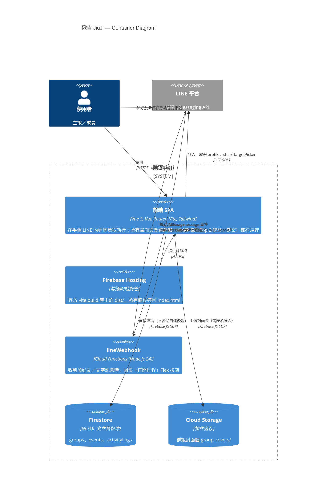

# 系統架構（C4 Model）

本文件以 [C4 Model](https://c4model.com/) 的 Level 1（System Context）與 Level 2（Container）描述「揪吉 JiuJi」。圖以 Mermaid 繪製，可直接在 GitHub 上渲染。

> **說明**：LINE Developers Console 內的設定（LIFF Endpoint URL、Webhook URL 指向哪裡）不在程式碼庫中，下列相關箭頭是依程式行為與 Firebase 慣例推論，標註為「（設定於 LINE Console）」。

---

## Level 1：System Context（系統情境圖）

回答「這個系統是給誰用的？它和哪些外部系統互動？」

**閱讀重點**

- 使用者**只在 LINE 裡**操作；LINE 同時扮演「入口」和「身分提供者」。
- 機器人**不進入任何 LINE 群組**。分享訊息是由主揪透過 LIFF 的 `shareTargetPicker` 自己選聊天室送出。

---

## Level 2：Container（容器圖）

回答「系統由哪些可獨立執行／部署的單元組成？它們怎麼溝通？」
（C4 的 Container 指「執行中的程式或資料儲存」，不是 Docker 容器。）

**閱讀重點**

1. **前端直連 Firestore**：`spa → firestore` 是主流程。沒有 REST API 層，也不經過 Cloud Functions。
2. **Cloud Functions 只服務機器人**：它被 LINE 呼叫（`line → fn`），前端程式碼中沒有任何地方呼叫它。
3. **身分來自 LIFF**：`liff.getProfile()` 取得的 `userId` 直接用作資料中的成員 id，Firebase Auth 只用匿名登入來通過 Storage 的上傳規則。
4. `remindPendingUsers`、`notifyEventFinalized` 兩個函式目前沒有實際功能，也無人呼叫，因此未畫入圖中。

---

## 容器清單

| 容器 | 技術 | 職責 | 對應位置 |
|---|---|---|---|
| 前端 SPA | Vue 3 + Vite | 全部 UI 與業務邏輯 | `src/` |
| Firebase Hosting | Firebase Hosting | 託管靜態前端 | `firebase.json` 的 `hosting` |
| lineWebhook | Cloud Functions | 機器人自動回覆 | `functions/index.js` |
| Firestore | Cloud Firestore | 主要資料儲存 | 由前端程式建立（見資料模型文件） |
| Cloud Storage | Firebase Storage | 封面圖 | `storage.rules` |
