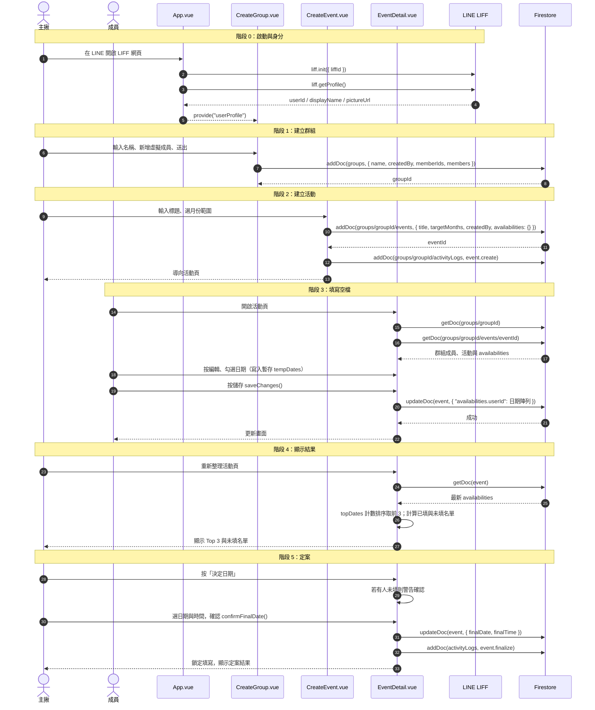

# 核心流程：建立揪團 → 填寫空閒時間 → 顯示結果

本文件追蹤主流程從「使用者操作」到「資料寫入 Firestore」所經過的檔案與函式，最後以 Sequence Diagram 呈現。

> 行號對應目前程式碼版本，程式異動後可能位移，請以函式名稱為準。

---

## 流程總覽

| 階段 | 使用者操作 | 檔案 | 關鍵函式／位置 | Firestore 動作 |
|---|---|---|---|---|
| 0. 啟動 | 在 LINE 開啟 LIFF 網頁 | `src/App.vue` | `onMounted`：`liff.init` → `liff.getProfile`；`provide("userProfile")` | 無 |
| 1. 建立群組 | 填名稱、新增虛擬成員、送出 | `src/views/CreateGroup.vue` | `handleCreate` | `addDoc(groups)` |
| 2. 建立活動 | 輸入標題、選起始月份與月數 | `src/views/CreateEvent.vue` | `targetMonths`（computed）、`handleCreate` | `addDoc(groups/{gid}/events)`、`addDoc(.../activityLogs)` |
| 3. 填寫空檔 | 開啟活動、按編輯、勾日期、儲存 | `src/views/EventDetail.vue` | `onMounted`、`startEditing`、`toggleDate`、`saveChanges` | `getDoc` ×2、`updateDoc(availabilities.{userId})` |
| 4. 顯示結果 | 查看 Top 3 與未填名單 | `src/views/EventDetail.vue`、`src/components/EventStats.vue` | `topDates`、`respondedUsers`、`pendingUsers`（皆為 computed） | 無（使用已載入的資料） |
| 5. 定案 | 主揪選日期與時間 | `EventDetail.vue`、`src/components/DecideModal.vue` | `handleDecideClick`、`confirmFinalDate` | `updateDoc(finalDate, finalTime)`、`addDoc(activityLogs)` |

---

## 各階段重點

### 0. 身分來源
- `App.vue` 的 `onMounted` 呼叫 `liff.init({ liffId })`，已登入則 `profile.value = await liff.getProfile()`。
- 以 `provide("userProfile", profile)` 提供給所有頁面，頁面以 `inject("userProfile")` 取得。
- 開發模式（`import.meta.env.DEV`）使用假帳號 `test_user_001`。
- `router.beforeEach` 會攔截標記 `requiresLineAuth` 的路由（建立／編輯群組、建立／編輯活動），未登入者導回列表。

### 1. 建立群組
- 建立者以 `role: "admin"` 加入 `members`；新增的朋友是虛擬成員，id 為 `virtual_${Date.now()}`、`isVirtual: true`。
- 成員同時寫成兩份：`memberIds`（陣列，供 `array-contains` 查詢）與 `members`（以 id 為 key 的物件，存名稱、頭像、角色）。
- 群組至少需 2 人（`MIN_GROUP_MEMBERS`）。

### 2. 建立活動
- 活動是群組的**子集合**：`groups/{groupId}/events/{eventId}`。
- 活動存的是「開放填寫的月份」`targetMonths`（如 `["2026-11","2026-12"]`），而非日期。
- 初始 `availabilities: {}`，之後每位成員在其中新增一個 key。

### 3. 填寫空檔
- 編輯時修改的是本地暫存 `tempDates`，按儲存才寫入。
- 寫入使用欄位路徑 `availabilities.${userId}`，只更新自己的 key，避免多人同時儲存時互相覆蓋。
- 活動已定案（有 `finalDate`）時，`toggleDate` 直接返回，成員無法再修改。
- 主揪／群組建立者可選擇「代填」虛擬成員，並寫入 `event.fillForVirtual` 動作紀錄。

### 4. 顯示結果
- `topDates`：走訪所有成員的日期陣列計數，依票數排序取前 3。
- 已填／未填：依各成員 `availabilities` 陣列是否為空判斷。
- 資料僅在頁面載入時讀取一次（程式中未使用 `onSnapshot`），他人的更新需重新整理才看得到。

### 5. 定案
- 僅活動建立者（`createdBy`）可定案；若仍有人未填，會先跳出警告確認。
- 「已定案」以 `finalDate` 是否有值判斷（不是獨立狀態欄位，也不搬移文件）；`finalTime` 為空字串表示只定日期。

---

## Sequence Diagram

