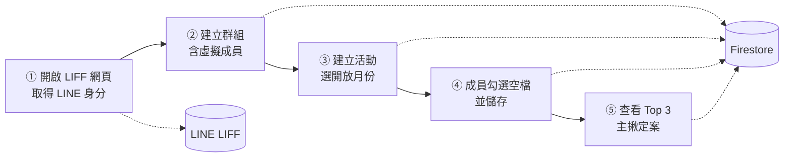
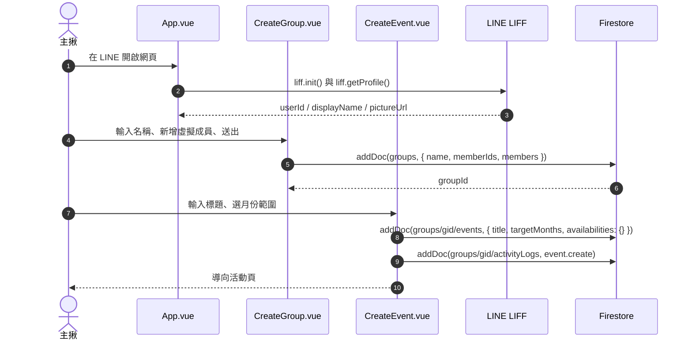
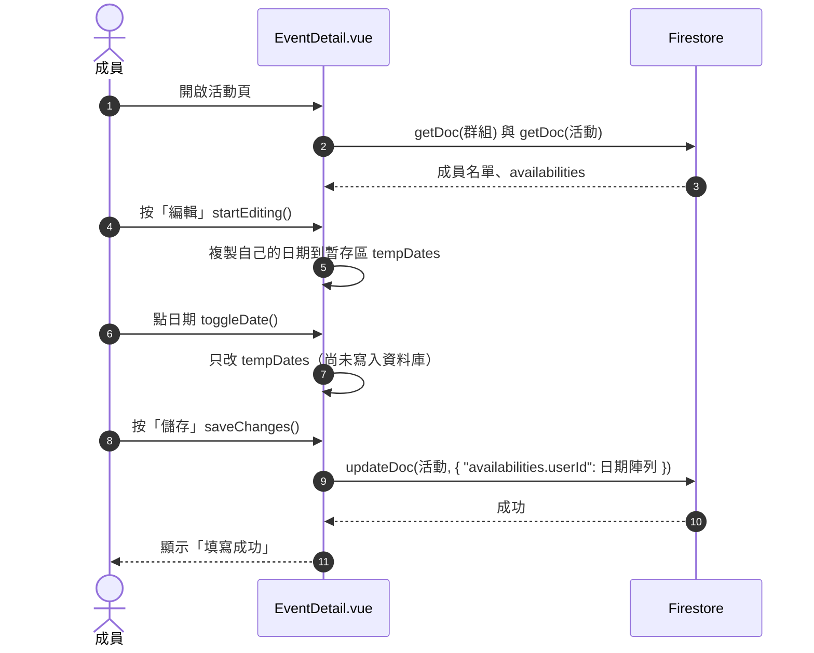
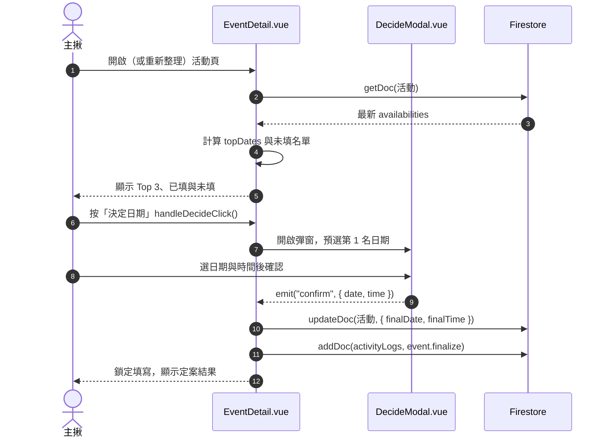

# 核心流程：建立揪團 → 填寫空閒時間 → 顯示結果

本文件追蹤主流程從「使用者操作」到「資料寫入 Firestore」所經過的檔案與函式。

閱讀順序：先看**總覽圖**掌握全貌，再依興趣看 3 張**細節圖**（每張聚焦一個情境）。

> 程式碼位置以函式名稱為準，行號會隨程式異動而位移。

---

## 總覽

| 階段 | 使用者做的事 | 主要檔案 | 寫入 Firestore |
|---|---|---|---|
| ① 啟動 | 在 LINE 開啟網頁 | `src/App.vue` | 無（向 LINE 取得 `userId`） |
| ② 建立群組 | 填名稱、新增虛擬成員 | `src/views/CreateGroup.vue` | 新增 `groups/{gid}` |
| ③ 建立活動 | 輸入標題、選月份範圍 | `src/views/CreateEvent.vue` | 新增 `groups/{gid}/events/{eid}` |
| ④ 填寫空檔 | 勾日期、按儲存 | `src/views/EventDetail.vue` | 更新 `availabilities.{userId}` |
| ⑤ 結果與定案 | 看 Top 3、選日期定案 | `EventDetail.vue`、`DecideModal.vue` | 新增 `finalDate`、`finalTime` |

---

## 如何閱讀 Sequence Diagram

| 圖上的元素 | 意思 |
|---|---|
| 最上方的方塊或小人 | **參與者**：人，或系統／檔案 |
| 往下的垂直線 | 該參與者的**時間軸**，越下面越晚 |
| 實線箭頭 | **請求**：左邊對右邊說「請做這件事」 |
| 虛線箭頭 | **回應**：做完後把結果回給發出請求的人 |
| 箭頭指向自己 | 該參與者**自己內部運算**，沒有呼叫別人 |
| 箭頭上的數字 | 發生順序 |

讀法：由上往下，一個箭頭一個箭頭讀，每個箭頭問「誰對誰做什麼」。

---

## 細節圖 A：建立群組與活動

涵蓋階段 ①②③。重點：身分來自 LINE，活動是群組底下的子集合。

**要點**
- `App.vue` 以 `provide("userProfile")` 把身分廣播給各頁面，頁面用 `inject("userProfile")` 取得。開發模式使用假帳號 `test_user_001`。
- `router.beforeEach` 會攔截標記 `requiresLineAuth` 的頁面（建立／編輯群組與活動），未登入者導回列表。
- 成員同時寫成 `memberIds`（陣列，供 `array-contains` 查詢）與 `members`（以 id 為 key 的物件）。
- 虛擬成員 id 為 `virtual_${Date.now()}`、`isVirtual: true`，等本人點邀請連結認領。
- 活動只存「開放哪幾個月」`targetMonths`，不存日期；`availabilities` 初始為空物件。

---

## 細節圖 B：成員填寫空檔

涵蓋階段 ④。重點：勾選只改本地暫存，儲存時只更新自己那一欄。

**要點**
- 暫存設計：關掉頁面前沒按儲存，勾選不會進資料庫。
- 欄位路徑寫法 `availabilities.${userId}` 只更新自己的 key；若改成整份覆蓋，兩人同時儲存時後者會蓋掉前者（lost update）。
- 活動已定案（有 `finalDate`）時 `toggleDate` 直接返回，成員無法再修改。
- 主揪或群組建立者可切換成虛擬成員「代填」，並多寫一筆 `event.fillForVirtual` 紀錄。

---

## 細節圖 C：查看結果與定案

涵蓋階段 ⑤。重點：Top 3 在前端計算，「已定案」只是多了 `finalDate` 欄位。

**要點**
- `topDates`：走訪所有人的日期陣列計數，依票數排序取前 3，純前端 computed，不經資料庫查詢。
- 未填名單：成員的 `availabilities` 陣列為空者。若仍有人未填，`handleDecideClick` 會先跳警告讓主揪確認。
- 只有活動建立者（`createdBy`）能定案，群組管理員也不行。
- 狀態判斷：`isFinalized = !!event.finalDate`，沒有獨立的 `status` 欄位。`finalTime` 為空字串代表只定日期。
- 資料只在頁面載入時讀取一次（程式中未使用 `onSnapshot`），他人更新需重新整理才看得到。這是可改善項目。
- 定案後的分享：主揪可用 LIFF 的 `shareTargetPicker` 把 Flex 卡片送到聊天室，不支援時改為複製文字。此步驟不經 Firestore。
