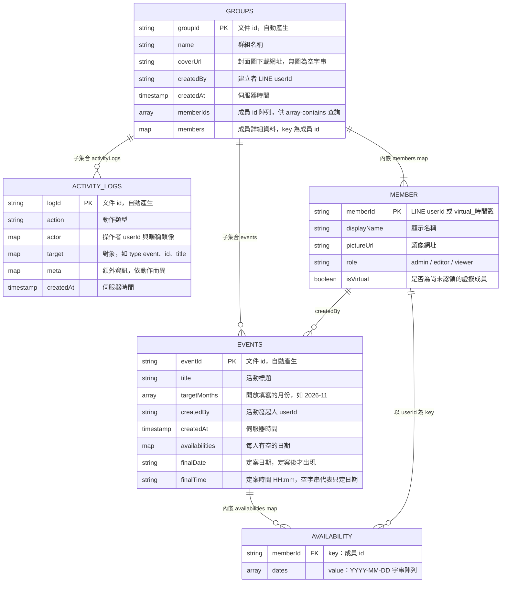

# 資料模型（Firestore）

揪吉使用 Cloud Firestore（NoSQL 文件資料庫）與 Cloud Storage。本文件整理集合結構、欄位用途與設計取捨。

> 本專案沒有獨立的後端 schema 定義，下列結構是由前端寫入資料的程式碼整理而來（`CreateGroup.vue`、`CreateEvent.vue`、`EventDetail.vue`、`JoinGroup.vue`、`EditGroup.vue`、`EditEvent.vue`、`utils/activityLog.js`）。

## Firestore 基本名詞

| 名詞 | 意思 |
|---|---|
| Collection（集合） | 一組文件的容器，類似資料夾 |
| Document（文件） | 一筆資料，由「欄位名稱：值」組成 |
| Subcollection（子集合） | 掛在某份文件底下的集合 |

## 結構總覽

```
groups/{groupId}                      群組
 ├─ events/{eventId}                  活動（子集合）
 └─ activityLogs/{logId}              動作紀錄（子集合）

Cloud Storage
 └─ group_covers/{timestamp}_{檔名}    群組封面圖
```

## ER 圖

成員（`members`）與空檔（`availabilities`）是**內嵌在文件裡的 map**，不是獨立集合，圖中以虛線框的概念實體表示。



---

## `groups/{groupId}`

| 欄位 | 型別 | 說明 | 寫入位置 |
|---|---|---|---|
| `name` | string | 群組名稱 | `CreateGroup`、`EditGroup` |
| `coverUrl` | string | 封面圖的 Storage 下載網址；未上傳為 `""` | 同上 |
| `createdBy` | string | 建立者的 LINE `userId`；判斷「群組擁有者」的依據 | `CreateGroup` |
| `createdAt` | timestamp | `serverTimestamp()` | `CreateGroup` |
| `memberIds` | array of string | 所有成員 id | `CreateGroup`、`EditGroup`、`JoinGroup` |
| `members` | map | key 為成員 id，value 為成員資料（見下表） | 同上 |

### `members` 的每個成員

| 欄位 | 型別 | 說明 |
|---|---|---|
| `displayName` | string | 顯示名稱 |
| `pictureUrl` | string | 頭像網址；虛擬成員為 `""` |
| `role` | string | `admin`（建立者）、`editor`（可建立活動）、`viewer`（僅檢視與填自己的空檔） |
| `isVirtual` | boolean | `true` 代表尚未有人認領的名額 |

### 設計重點

1. **`memberIds` 與 `members` 並存（denormalization，反正規化）**
   `GroupList.vue` 用 `where("memberIds", "array-contains", userId)` 找出「我參加的群組」。多存一份純 id 陣列讓查詢簡單，詳細資料則放在 `members`。代價是兩者必須同步更新，目前由各頁面程式各自維護。
2. **虛擬成員（virtual member）**
   主揪建立群組時可先建立名額，id 為 `virtual_${Date.now()}`。本人點邀請連結「認領」時，`JoinGroup.vue` 會把 `members` 與 `memberIds` 中的虛擬 id 換成真實 `userId`，並走訪該群組所有活動，把 `availabilities` 搬到新 id 下。此流程不是原子操作（見風險清單）。

---

## `groups/{groupId}/events/{eventId}`

| 欄位 | 型別 | 說明 | 備註 |
|---|---|---|---|
| `title` | string | 活動標題 | |
| `targetMonths` | array of string | 開放填寫的月份，格式 `YYYY-MM`，最多 3 個月 | 存月份，不是日期 |
| `createdBy` | string | 活動發起人 `userId` | 定案、編輯、刪除權限依據 |
| `createdAt` | timestamp | `serverTimestamp()` | 活動列表以此排序、分頁 |
| `availabilities` | map | key 為成員 id，value 為 `YYYY-MM-DD` 字串陣列 | 建立時為空物件 `{}` |
| `finalDate` | string | 定案日期 | **定案後才出現** |
| `finalTime` | string | 定案時間 `HH:mm`；`""` 代表只定日期 | **定案後才出現** |

### 設計重點

1. **子集合**：活動掛在群組底下，路徑為 `groups/{gid}/events/{eid}`，查詢某群組的活動不需要過濾條件。刪除群組時必須手動刪子集合（Firestore 不會自動連帶刪除，見 `EditGroup.vue` 的 `deleteGroupSubcollections`）。
2. **`availabilities` 用欄位路徑更新**：儲存時寫 `updateDoc(ref, { ["availabilities." + userId]: dates })`，只改自己那一欄，避免多人同時儲存互相覆蓋（lost update）。
3. **「已定案」沒有獨立狀態欄位**：以 `finalDate` 是否有值判斷。活動列表的「已定案」計數使用 `where("finalDate", ">", "")`，並以 `getCountFromServer` 做聚合計數。
4. **單一文件容量**：所有人的空檔都在同一份活動文件裡。Firestore 單一文件上限約 1 MiB，對於一般揪團人數與月份數十分足夠，但極端情況（很多成員、很多月份）需要留意。

---

## `groups/{groupId}/activityLogs/{logId}`

| 欄位 | 型別 | 說明 |
|---|---|---|
| `action` | string | 動作類型，見下表 |
| `actor` | map | `{ userId, displayName, pictureUrl }`，操作者 |
| `target` | map 或 null | 如 `{ type: "event", id, title }` |
| `meta` | map | 依動作而異的補充資訊 |
| `createdAt` | timestamp | `serverTimestamp()` |

### 已實際寫入的 `action`

| action | 觸發位置 | `meta` |
|---|---|---|
| `event.create` | `CreateEvent.vue` | 無 |
| `event.update` | `EditEvent.vue` | `oldTitle`、`newTitle`、`titleChanged`、`timeRangeChanged` |
| `event.delete` | `EditEvent.vue` | 無 |
| `event.finalize` | `EventDetail.vue` | `finalDate`、`finalTime` |
| `event.fillForVirtual` | `EventDetail.vue` | `forUserId`、`forDisplayName` |

> `GroupDetail.vue` 的顯示邏輯另有 `event.remind` 分支，但目前沒有任何程式碼寫入此類紀錄。

群組首頁讀取最新 20 筆（`orderBy("createdAt", "desc")`、`limit(20)`）。

---

## Cloud Storage

| 路徑 | 說明 |
|---|---|
| `group_covers/{Date.now()}_{原檔名}` | 群組封面圖。資料庫只存下載網址（`coverUrl`），不存圖片本身 |

`storage.rules` 規定：`group_covers/` 可公開讀取；寫入需通過 Firebase Auth（本專案使用匿名登入）、檔案小於 5 MB 且 `contentType` 為圖片；其他路徑一律禁止。

---

## 常用查詢

| 用途 | 查詢 | 位置 |
|---|---|---|
| 我參加的群組 | `groups` where `memberIds` array-contains `userId` | `GroupList.vue` |
| 群組的活動（分頁） | `events` orderBy `createdAt` desc、limit 10、`startAfter` 游標 | `GroupDetail.vue` |
| 活動總數、已定案數 | `getCountFromServer`，已定案用 where `finalDate` > `""` | `GroupDetail.vue` |
| 最新動作紀錄 | `activityLogs` orderBy `createdAt` desc、limit 20 | `GroupDetail.vue` |
